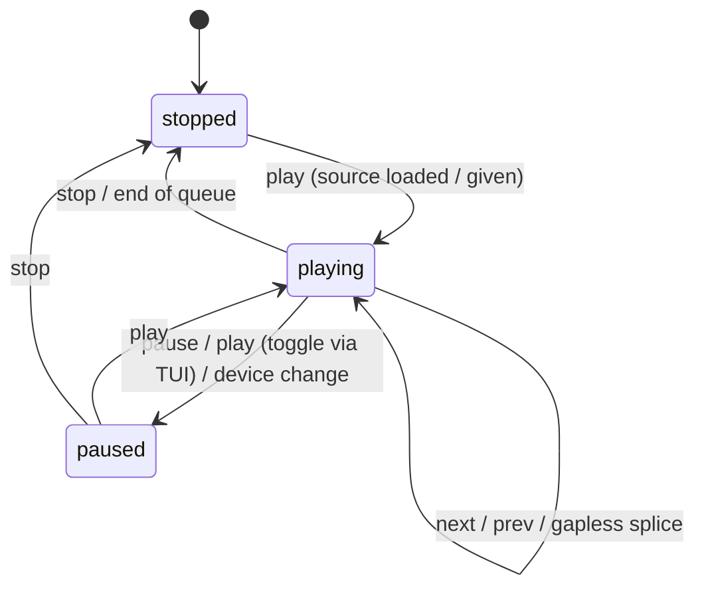
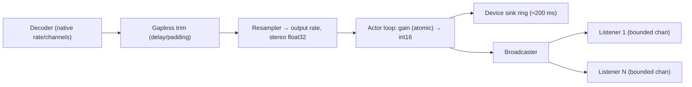

# eklips — Architecture

This document is the contract for the implementation. Where `specsheet.md` was
ambiguous, the resolution chosen here is recorded under
[Resolved ambiguities](#resolved-ambiguities).

## 1. Decisions

| Area | Decision |
| --- | --- |
| Process model | A long-running daemon owns the playback engine, state, and database. CLI commands and the TUI are thin HTTP clients. One-shot CLI processes never hold state. |
| UI | Headless by default. `eklips`, `eklips serve`, and `eklips start` never initialise a UI. `eklips tui` is an opt-in client compiled into the same binary. |
| TUI | Attaches over HTTP, owns no playback state, never embeds an engine. If no local daemon answers `/api/v1/health`, it re-executes the same binary detached (`serve` + forwarded flags), waits ≤5 s for health, then attaches. `--no-start` disables this, `--remote` never auto-starts, `--stop-on-exit` stops only a daemon this TUI started. |
| Control plane | One HTTP API under `/api/v1`, bound to `127.0.0.1:8080` by default. The same handlers serve the CLI, TUI, external HTTP clients, and tests. |
| Events | `GET /api/v1/events` (SSE). Full snapshot on connect, then typed incremental events. Heartbeat comment every 15 s. `Last-Event-ID` replays from a 256-event ring; if the id is too old, a fresh snapshot is sent. |
| Sinks | `device`, `http`, `both`, `null` (tests). Default `device`; Docker defaults to `http`. |
| Docker | No sound card assumed. Stream-first (`--sink=http --bind=0.0.0.0`). `/dev/snd` passthrough is an opt-in for device mode. |
| Database | SQLite through `modernc.org/sqlite` (pure Go). WAL, `foreign_keys=ON`, `busy_timeout=5000`, embedded versioned migrations, prepared statements, a single writer goroutine. Default path `$XDG_DATA_HOME/eklips/eklips.db` → `~/.local/share/eklips/eklips.db`; `--db` overrides; Docker uses `/data/eklips.db`. |
| State model | Playback `stopped | playing | paused`; source `single | playlist`. The loaded queue persists across `stop` and restarts. On boot, queue and volume are restored as `stopped` unless `--resume-on-start` (or the `resume_on_start` setting) is enabled. |
| Formats | Native: WAV (PCM 8/16/24/32, float32), MP3 (`hajimehoshi/go-mp3`), OGG/Vorbis (`jfreymuth/oggvorbis`), FLAC (`mewkiz/flac`). Optional FFmpeg subprocess decoder for M4A/AAC/Opus/etc. when `ffmpeg` is on `PATH`. Otherwise `UNSUPPORTED_FORMAT`. |
| Platform | Linux first (ALSA output via `ebitengine/oto/v3`, PipeWire/PulseAudio device-change detection via `pactl`). macOS/Windows best-effort. |
| cgo | Only the device sink needs cgo (ALSA on Linux). It is isolated behind the `cgo` build tag; `CGO_ENABLED=0` builds return `SINK_UNAVAILABLE` for `device`/`both`. |
| Security | Loopback bind; bearer token mandatory on non-loopback binds unless `--allow-remote`; paths normalised and optionally restricted with `--media-root`; no shell interpolation (direct `exec`); 64 KiB request body limit; header/read timeouts; non-root container; token never logged or persisted. |
| Playlist schema | Versioned JSON: `{ "version": 1, "name": "...", "tracks": [{ "path": "..." }] }`. Relative paths resolve against the playlist file's directory. |

## 2. Package layout

```
cmd/eklips            entry point; dispatches to internal/cli
internal/apperr       error codes, HTTP status mapping, JSON envelope
internal/config       daemon/client options, defaults, path resolution
internal/media        supported extensions, folder scan with natural sort
internal/playlist     JSON parse/validate/generate
internal/core         pure state machine (no I/O)
internal/audio        decoders, resampler, gapless trimming, PCM helpers
internal/sink         Sink interface; null, device (cgo), HTTP broadcaster
internal/engine       playback actor: core + audio + sinks + events + persistence
internal/events       event bus with replay ring
internal/store        SQLite persistence and migrations
internal/server       HTTP API v1
internal/client       HTTP client shared by CLI and TUI
internal/daemon       lifecycle: serve, background start, single-instance lock
internal/devwatch     output-device change detection
internal/tui          Bubble Tea client
```

## 3. State machine



Precondition checks run in this order: `NO_MEDIA_LOADED` → `PLAYLIST_REQUIRED` → `INVALID_STATE` → bounds (`VOLUME_MAX`/`VOLUME_MIN`).

| Command | Requires | Errors |
| --- | --- | --- |
| `play <path>` | — | `FILE_NOT_FOUND`, `UNSUPPORTED_FORMAT`, `DECODE_ERROR`, `INVALID_PLAYLIST` |
| `play` | source | `NO_MEDIA_LOADED`; idempotent when already playing |
| `pause` | source, `playing` | `NO_MEDIA_LOADED`, `INVALID_STATE` |
| `stop` | source, `playing`/`paused` | `NO_MEDIA_LOADED`, `INVALID_STATE` |
| `next` / `previous` | playlist, `playing`/`paused` | `NO_MEDIA_LOADED`, `PLAYLIST_REQUIRED`, `INVALID_STATE` |
| `louder` / `quieter` | source | `NO_MEDIA_LOADED`, `VOLUME_MAX`, `VOLUME_MIN` |
| `mute` | source | `NO_MEDIA_LOADED` |
| `shuffle` / `loop` | playlist | `NO_MEDIA_LOADED`, `PLAYLIST_REQUIRED` |
| `status` | — | never fails (reports empty source) |

Queue semantics:

- The queue is the list of tracks plus a play *order* (identity, or a permutation when shuffled) and a cursor into that order.
- Enabling shuffle builds a permutation whose first element is the current track, so the current track is not restarted. Disabling shuffle restores identity order with the cursor on the current track.
- `next` at the last track: wraps if loop is on, otherwise `INVALID_STATE` ("end of playlist").
- `previous` at the first track: wraps if loop is on, otherwise restarts the first track.
- Natural end of queue without loop → `stopped`, cursor reset to the first track.
- Single-file sources may be loaded with `--loop`; the file then repeats gaplessly.
- Volume steps are 5 within `0..100`; mute is independent of volume (volume changes do not unmute).

## 4. Playback pipeline



- **Actor model.** One goroutine (the *engine loop*) owns the `core.Machine`, the current decoder, and the prefetched decoder. Commands arrive over a channel and get a reply; readers get lock-free snapshots via `atomic.Pointer`. There is no lock in the audio path.
- **Fixed output format.** 44 100 Hz (configurable via `--sample-rate`), stereo, signed 16-bit little-endian. Tracks at other rates are resampled (linear) per track so splices are sample-accurate in the output domain.
- **Chunking.** 20 ms chunks (882 frames at 44.1 kHz). Buffers are preallocated; stream chunks come from a `sync.Pool` and are reference-counted across listeners.
- **Clock.** The device sink paces the loop (blocking ring write). Without a device, a wall-clock pacer paces the loop at 1× so HTTP listeners receive real time audio.
- **Gapless.** When less than 10 s of the current track remains, a helper goroutine opens the next track (chosen with current shuffle/loop state) and pre-decodes ~0.5 s. On EOF the remainder of the current chunk is filled from the next track — a sample-accurate splice with no output reset. Index/metadata events are emitted at the splice. Prefetch is one track at most; any command that changes queue, shuffle, or loop bumps a generation counter that invalidates the prefetch. Undecodable tracks are skipped with an `error` event; if none remain, playback stops.
- **Encoder delay/padding.** MP3: LAME/Xing tag delay+padding (plus the 529-sample decoder delay) trimmed. FLAC/WAV are exact. Vorbis end-trim is handled by the decoder's granule positions. AAC via FFmpeg relies on FFmpeg's iTunSMPB/edit-list handling.
- **Slow consumers.** Each HTTP listener has a bounded channel (2 s of audio). If full, the listener is evicted; the decoder never blocks on a listener.
- **Paused/stopped streams.** While not playing, the loop emits 20 ms silence chunks only if HTTP listeners are connected, so connections stay open; with no listeners the loop blocks on its command channel (zero idle CPU).
- **Stream format.** `audio/wav` with a streaming RIFF header (sizes set to max), followed by raw PCM. Live streams do not support byte ranges: `Accept-Ranges: none`, Range headers are ignored and a 200 is returned (RFC 9110 permits this).

## 5. Database schema

```sql
schema_migrations(version INTEGER PRIMARY KEY, applied_at TEXT)
settings(key TEXT PRIMARY KEY, value TEXT)
aliases(name TEXT PRIMARY KEY, playlist_path TEXT, created_at TEXT, updated_at TEXT)
playlists(id INTEGER PRIMARY KEY, name TEXT, source_path TEXT UNIQUE, created_at TEXT, updated_at TEXT)
playlist_tracks(playlist_id INTEGER REFERENCES playlists(id) ON DELETE CASCADE, position INTEGER, path TEXT, PRIMARY KEY(playlist_id, position))
playback_state(id INTEGER PRIMARY KEY CHECK(id = 1), source_type TEXT, source_path TEXT, current_index INTEGER, position_ms INTEGER, state TEXT, volume INTEGER, muted INTEGER, shuffle INTEGER, loop INTEGER, updated_at TEXT)
```

- Loading a playlist (folder or JSON) upserts it into `playlists`/`playlist_tracks` in one transaction (import). On restore, the source is re-resolved; if the source path no longer resolves, the stored tracks are used.
- A single persister goroutine writes `playback_state`. Transitions are written immediately (coalesced); position-only updates at most every 5 s; final write on shutdown.
- `PRAGMA user_version` above the binary's latest migration → `DB_ERROR` ("database schema is newer"). Corrupt files (`SQLITE_NOTADB`) and locked files fail with `DB_ERROR`, never silently reset.
- Single-instance: an exclusive `flock` on `<db>.lock`.

## 6. Event stream

```
id: 42
event: volume
data: {"volume":55,"muted":false}
```

Event types: `snapshot`, `state`, `track`, `queue`, `volume`, `mute`, `shuffle`, `loop`, `error`, `device`. `snapshot`/`track`/`state` carry the full status object; others carry the changed fields. Heartbeat: `: ping` every 15 s. Subscribers have a 64-event buffer; overflow evicts the subscriber (client reconnects with `Last-Event-ID`).

## 7. Performance budgets

| Metric | Budget |
| --- | --- |
| Stream listeners at 1× without dropouts | ≥ 10 (default max 32) |
| Idle CPU (stopped, no listeners, no TUI) | ≈ 0 — no timers running |
| Memory | bounded: device ring 200 ms, 2 s per listener, ≤1 prefetched track (0.5 s prebuffer + decoder state), queue ≤ 10 000 tracks |
| DB writes during steady playback | ≤ 1 per 5 s |
| Decode throughput (WAV/FLAC) | ≥ 50× real time on one core |
| Gapless splice | 0 inserted samples; < 1 chunk of extra work |
| Fan-out publish (10 listeners, 20 ms chunk) | < 20 µs |
| Status/command HTTP latency (loopback) | < 5 ms p99 excluding decoder open |
| TUI | 4 Hz tick only while playing; ≤ 30 FPS; View() < 200 µs |

Benchmarks in `internal/audio`, `internal/sink`, `internal/engine`, `internal/store`, and `internal/tui` are the acceptance gates; `scripts/bench.sh` compares against `bench/baseline.txt` with `benchstat`.

## 8. Resolved ambiguities

1. **`next`/`previous` when stopped.** The spec lists both `PLAYLIST_REQUIRED` and "requires active playback". Resolution: single-file → `PLAYLIST_REQUIRED`; playlist but stopped → `INVALID_STATE`.
2. **`status` with nothing loaded.** The state model says status requires a source, but `eklips status` must report daemon status. Resolution: status always succeeds and reports `source_type: ""`.
3. **`loop` for single files.** The `loop` toggle requires a playlist, but `play --loop` may target a single file. Resolution: `play <file> --loop` repeats the file; the `loop` toggle still requires a playlist.
4. **Shutdown endpoint.** `eklips quit` and TUI `Q` need an API: `POST /api/v1/shutdown` (authenticated).
5. **Byte ranges on a live stream.** Not feasible; documented as `Accept-Ranges: none`.
6. **Health endpoint** is unauthenticated (Docker healthcheck, TUI probe) and reveals only `{"status":"ok","version":...}`.
